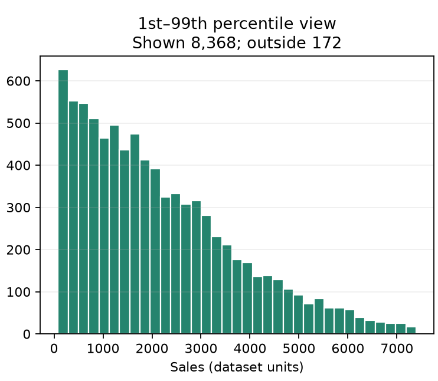
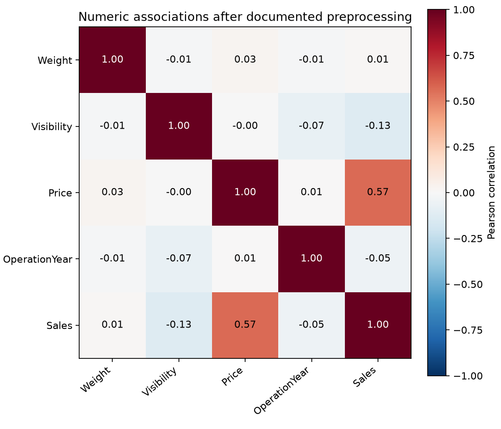
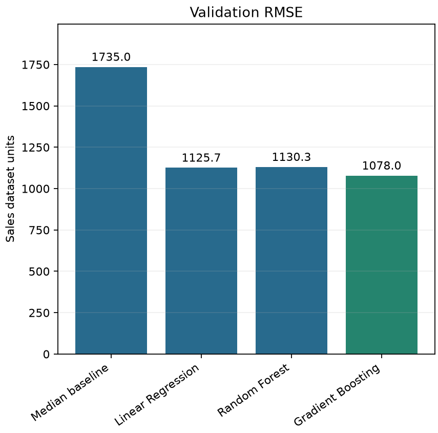

# Executive Summary

Product price and store context provide useful information for predicting Sales, but data quality and limited business definitions restrict operational interpretation. Analysis of 8,540 supplied retail records identified missing attributes, inconsistent labels, duplicate content and several extreme or negative targets. Explicit screening retained 8,532 records for the primary analysis while preserving the original values and an audit trail. Price had a correlation of 0.568 with Sales after descriptive preprocessing. Store format showed substantial differences, although format, size, location and store identity were interdependent.

Gradient Boosting achieved the lowest internal validation error among three regression models, with MAE 756.03, RMSE 1,078.02 and R² 0.5963. Training-only cross-validation also selected this model. Store-level statistical comparisons did not establish a significant difference between the three candidates. The supplied test file had no observed Sales labels, so its 5,681 predictions have unknown accuracy.

Google Analytics 4 recorded eight controlled Kiwi Outdoor purchases on 3 November 2026, comprising 11 items and NZ$377 simulated revenue. Processed reports matched the order records, but the one-user funnel could not describe customer conversion. A separate automated run on 4 November completed 30 synthetic scenarios and 11 demo purchases worth NZ$1,117. Purchase payloads matched outbound requests, but GA4 reporting remained unconfirmed. These tests support measurement review rather than claims about customer demand. Priorities are source-data verification, cautious forecast review and genuine web-data collection.

# 1 Business Context and Data

This report examines how retail analysis and web analytics can support sales decisions. The retail investigation asks which product and store attributes are associated with Sales and how accurately available features predict it. The web investigation examines the measurement of actions preceding a purchase. Together, they distinguish expected sales performance from the observable steps through which website activity becomes a transaction. Recommendations concern planning and further investigation rather than proven causal interventions.

The supplied train.csv contains 8,540 rows and 14 columns, representing 1,562 item IDs and ten stores. Predictors describe Weight, Fat, Visibility, Category, Price, Security, StoreCode, OperationYear, Size, Area and Type. No is a sequence number; ID identifies an item. The accompanying README defines Sales as an item-at-store performance measure but specifies neither its units nor its observation period. Currency, quantities sold, returns, promotion dates and margins are unavailable. Retail Sales is therefore expressed in dataset units and is not automatically interpreted as monetary revenue or physical demand.

The supplied test.csv contains 5,681 rows with the same schema, but every Sales value is missing. It supports prediction, not direct supervised scoring. Kiwi Outdoor is a separate five-product demonstration website linked to a dedicated GA4 property. Its purchases are simulated and involve no payment or delivery. Retail records and website events describe different observations and cannot be joined as common transactions. All retail calculations and graphics were produced in Python. Web evidence comprises verified GA4 reports for 3 November and separately checked browser records for the additional simulation on 4 November.

# 2 Exploratory Analysis and Preprocessing

## 2.1 Initial Inspection and Univariate Analysis

Inspection combined dimensions, data types, missing counts, numeric quantiles, category frequencies and record-level anomaly checks. Weight was missing in 1,466 records, or 17.17%, and Size in 2,415, or 28.28%. Fat contained equivalent spellings including LF, low fat and reg. No complete row duplicates appeared when No was included, but ignoring the sequence revealed one exact content duplicate. There were also 15 repeated item-store occurrences beyond the first. Differing values in those pairs require investigation because no date or transaction identifier resolves their meaning.

**Raw training statistics**

 | Variable | Median | 1st percentile | 99th percentile | 
 | --- | --- | --- | --- | 
 | Sales | 1,794.33 | 80.16 | 7,412.54 | 
 | Price | 143.03 | 34.99 | 263.13 | 
 | Weight | 12.60 | 5.15 | 20.85 | 
 | Visibility | 0.0539 | 0.0000 | 0.2272 | 

Raw means were strongly influenced by extreme observations. Mean Sales was 26,730.40, compared with a median of 1,794.33 and a 99th percentile of 7,412.54. Its largest observation was approximately 100 million. Three extreme positive records accounted for about 91.86% of the raw Sales sum, including negative values. These discrepancies made a single mean or an ordinary full-range histogram a poor description of typical records.

Histograms showed distribution shape, box plots highlighted dispersion and extreme observations, and focused percentile views revealed the central range. Figure 1 presents the central 98% of raw Sales; observations outside that view remain in the source data. Numeric box plots used symmetric logarithmic axes where negative and very large values coexisted. Category and Type frequencies used horizontal bars because their long labels are easier to compare than rotated labels or pie segments. Frequencies describe records, not distinct customers or demand.

## 2.2 Quality Rules and Descriptive Preprocessing

Four negative Sales values and three exceptionally large positive targets were quarantined from the primary analysis. The fixed positive review boundary was 1,000,000. Review boundaries of 100,000 and 10,000,000 identified the same seven target records. This establishes stability across those cutoffs, not proof that the records are errors. Negatives could represent returns, and exceptional sales could be genuine. Removing one exact content duplicate alongside target quarantine left 8,532 eligible records. Other conflicting item-store pairs were retained and subsequently grouped during evaluation.

**Quality checks and treatments**

 | Issue | Records | Primary treatment | 
 | --- | --- | --- | 
 | Weight missing | 1,466 | Item median then overall median | 
 | Size missing | 2,415 | Retain Unknown category | 
 | Weight / Price / Visibility bounds | 7 / 6 / 1 | Mark missing using fixed review rules | 
 | Year outside review bounds | 2 | Missing then store consistency mapping | 
 | Target review rule | 7 | Quarantine from primary analysis | 
 | Duplicate content excluding No | 1 | Keep first exact content record | 

Weight outside (0, 100], Price outside (0, 1,000], and Visibility outside [0, 1] were marked missing. These deliberately broad bounds identify values separated from the dominant distributions; undocumented units make them provisional rather than universal business limits. Zero Visibility was retained. Most visibility values suggest fractional storage, but the README's percentage description does not confirm the scale. Automatic deletion of zero observations would impose an unsupported explanation for missing exposure.

Opening years outside 1900–2026 were initially marked missing. A store's valid-year mode replaced inconsistent years only when at least five observations provided at least 90% agreement. This also addressed an in-range minority year such as 1957. The justification was consistency of an opening-year attribute within a store, rather than an assumption that every historical year is impossible. Fat spellings were standardised deterministically. Missing Size remained Unknown because missingness was concentrated within particular stores; assigning a common size would invent an observed attribute.

Missing or flagged Weight first used a valid same-item median, followed by the overall median where no lookup was available. Other numeric gaps used medians. The resulting Task 1 copy supports description, but was not reused as the input to model evaluation. In Task 2, these lookups and all other learned transformations were fitted only within the relevant training subset. This distinction limits preprocessing leakage, consistent with scikit-learn developers' guidance (n.d.-a). Every changed feature and excluded row was recorded so conclusions can be revisited if corrected source records become available.

## 2.3 Relationships with Sales

Raw Price-Sales Pearson correlation was approximately 0.661, whereas the post-preprocessing correlation was 0.568. Raw Weight-Sales correlation was approximately 0.271 but fell to 0.014 in the descriptive copy. Visibility-Sales correlation was −0.129 after preprocessing. The differences show that a relationship driven by extreme observations need not describe ordinary records. Figure 2 presents the cleaned numeric correlation matrix. Correlation measures association and does not establish that a feature intervention changes Sales.

Price remained positively associated with Sales within store formats. Mean Sales increased from 948.59 in the lowest price quartile to 3,444.77 in the highest. Product value and assortment therefore warrant joint investigation. However, the missing quantity and margin definitions prevent estimating price elasticity or profitability. Raising prices because a positive correlation exists would confuse observed product differences with a causal pricing effect.

Multivariate cross-tabulations and store profiles showed why categorical relationships need joint interpretation. Mean Sales was 3,691.64 for Supermarket Type3 and 339.09 for Grocery Store, but Type3 represented one store, as did Type2. Type1 represented six stores and Grocery Store two. Size, Area and opening year were closely linked to store identity. Medium stores' apparent advantage could partly reflect format composition. A numeric heatmap alone cannot expose these categorical dependencies, so it was supplemented with Type-by-Size and Type-by-Area tables and conditional Price-Sales plots.

Category and Security summaries also contained differences, but unequal category sizes and store composition limit their interpretation. Security-provider averages do not measure supplier effectiveness. Weak marginal relationships for Weight and Visibility do not justify automatic feature removal because interactions may still contribute predictive information. The business finding is that product and store context should be considered together when reviewing targets and allocation, while store-format comparisons should remain descriptive rather than a case for changing physical store size or location.

# 3 Regression Modelling and Evaluation

## 3.1 Validation Design and Pipelines

The absence of labelled test targets required an internal validation design. Eligible rows were reconstructed from raw train.csv, then unique item-store groups were randomly divided 80/20 with seed 42. This produced 6,826 training rows and 1,706 validation rows. Group rather than exact row proportions explain the small difference from a mathematically exact 80/20 row allocation. No item-store group crossed partitions. This prevents repeated versions of a pair appearing in both sets, although individual products and stores can still occur on each side.

No was excluded as a sequence. Item ID was excluded from regression encoding because of its high cardinality, but remained available for grouping and Weight lookup. StoreCode was categorical: the intended prediction concerns additional combinations within the observed store network. The design does not evaluate wholly new stores or future periods. Full-data EDA informed the review rules, so validation is a development estimate rather than an untouched confirmatory test.

Each model received an independent pipeline. Learned item medians, store-year mappings, global medians, standardisation and one-hot encoding were fitted on training rows only. Unknown categories were handled without refitting. Numeric scaling supports the linear model; using the same representation for tree models maintains comparable inputs. Five-fold GroupKFold within the training portion compared fixed specifications using mean fold RMSE. Every fold fitted fresh preprocessing. The selected candidate was then evaluated on the held-out portion without retuning to its results.

## 3.2 Models and Metrics

Linear Regression provided a simple least-squares benchmark. Random Forest used 100 trees to capture nonlinear splits and interactions by averaging trees. Gradient Boosting used 100 depth-three trees with learning rate 0.1 to build successive corrections. Both ensembles used random_state=42. These contrasting specifications test whether flexible feature relationships improve prediction over a linear representation; they do not establish the true functional form of Sales (scikit-learn developers, n.d.-b, n.d.-c, n.d.-e).

A training-median baseline provided a practical reference. MAE measures average absolute error in Sales units; MSE averages squared error in squared units; RMSE returns that quantity to Sales units and emphasises large misses. R² measures squared-error performance relative to variation around the validation mean and can be negative. It is not a percentage of individually correct predictions (scikit-learn developers, n.d.-d). These metrics serve different decisions: MAE describes average error magnitude, while RMSE highlights sensitivity to costly large misses. None directly measures inventory shortage cost or financial loss without additional business assumptions.

**Internal validation metrics**

 | Model | MAE | MSE | RMSE | R² | 
 | --- | --- | --- | --- | --- | 
 | Median baseline | 1,303.62 | 3,010,159.28 | 1,734.98 | -0.0457 | 
 | Linear Regression | 827.99 | 1,267,162.56 | 1,125.68 | 0.5598 | 
 | Random Forest | 787.48 | 1,277,545.73 | 1,130.29 | 0.5562 | 
 | Gradient Boosting | 756.03 | 1,162,133.71 | 1,078.02 | 0.5963 | 

## 3.3 Predictive Results and Business Meaning

Training CV selected Gradient Boosting with mean fold RMSE 1,095.05 and fold standard deviation 18.25. Corresponding means were 1,131.42 for Random Forest and 1,132.86 for Linear Regression. Fold variation is descriptive, not a confidence interval. On validation, Gradient Boosting also had the lowest MAE and RMSE and the highest R² among the three candidates. Its RMSE of 1,078.02 was approximately 37.9% below the median baseline's 1,734.98. Figure 3 compares errors on the same validation observations.

An MAE of 756.03 indicates substantial average error in the unspecified Sales measure, despite improvement over the baseline. Random Forest reduced MAE relative to Linear Regression but slightly worsened RMSE and R²; model ranking therefore depends on the error criterion. The distinction matters if occasional large misses carry disproportionate operational consequences. Without cost information, selecting the lowest CV RMSE is transparent, but does not establish optimal stock levels or acceptable financial risk.

Segment diagnostics also qualify the aggregate result. Gradient Boosting's MAE was 238.22 for Grocery Store and 1,010.11 for Type3, whose mean validation Sales was much higher. Mean residuals, defined as actual minus predicted, were −98.28 and +204.03 respectively. This suggests checking overprediction in grocery records and underprediction in Type3 records, without attributing the difference to format alone. Fourteen validation predictions and 35 final test predictions were negative. Raw outputs were retained; a nonnegative constraint would need training-side assessment before operational adoption.

## 3.4 Statistical Comparison and Final Predictions

The statistical question was whether the three fitted models had systematically different prediction-error ranks across stores. The null hypothesis specified no systematic rank difference in store-level MAE; the alternative specified a difference involving at least one model. Ten stores formed paired blocks. Averaging absolute errors within each store avoided treating thousands of correlated retail rows as independent experimental replicates. This gives each store equal weight, whereas the main validation metrics weight records equally.

Friedman's statistic was 3.8000, with approximate p=0.1496. SciPy warns that its chi-square approximation is unreliable for small numbers of blocks and repeated samples; ten stores and three models do not satisfy its stated reliability guidance (SciPy community, n.d.-a). A seeded within-store label-permutation calculation with 9,999 permutations gave p=0.1868. At α=0.05, the null was not rejected. Kendall's W was 0.190. Permutation validity still depends on exchangeability under the null and suitably independent blocks.

**Paired store comparisons**

 | Pair | Raw p | Holm adjusted p | 
 | --- | --- | --- | 
 | Linear Regression and Random Forest | 0.7695 | 0.7695 | 
 | Linear Regression and Gradient Boosting | 0.3223 | 0.6445 | 
 | Random Forest and Gradient Boosting | 0.1309 | 0.3926 | 

Supplementary two-sided Wilcoxon comparisons of store MAEs were adjusted across the three pairs using Holm's method. None met the 0.05 threshold. Paired differences were rounded before ranking; zeros were discarded. Wilcoxon concerns the symmetry of paired differences around zero, not directly equality of headline RMSE (SciPy community, n.d.-b). Shared products, common training data and unverified independence limit all these comparisons. Non-significance does not prove equivalence, and the exploratory numerical preference for Gradient Boosting remains distinct from a significant superiority claim.

Finally, a fresh selected pipeline was fitted to all 8,532 eligible labelled records and predicted the 5,681 supplied test rows in their original order. Test rows contributed no fitted preprocessing information. Missing Sales labels were not replaced with zero or invented values. The reported metrics remain internal validation results; the supplied-test predictions have unknown accuracy. The practical recommendation is to use predictions for reviewing item-store expectations while obtaining independently labelled outcomes before relying on them for consequential allocation decisions.

# 4 Web Analytics Using Google Analytics 4

## 4.1 Website and Measurement Design

Kiwi Outdoor sells five demonstration products through product pages, a cart and a simulated checkout. Its dedicated GA4 property records view_item, add_to_cart, view_cart, begin_checkout and purchase. Purchase payloads include a unique transaction ID, NZD currency, value and item-level price and quantity. Every event carries a simulated_transaction marker. No real payment, shipment or personal checkout information is involved. The marker identifies simulated activity but does not automatically exclude it from standard revenue reports.

GA4 was selected to connect product activity with purchases. Its Ecommerce purchases report provides item-level measures when ecommerce events are implemented, rather than automatically creating them from a storefront (Google, n.d.-a). The analysis period was restricted to 3 November 2026 to isolate eight additional controlled orders from earlier verification traffic. Browser receipts, event payloads and GA4 Realtime transaction IDs and values were reconciled. Standard processed reports were subsequently checked, establishing evidence beyond a local event queue.

## 4.2 Processed Ecommerce Findings

The standard report contained 14 items viewed, 13 added to cart, 11 purchased and NZ$377 item revenue. Purchased quantities and product revenue matched the saved order records. Eleven items represent quantities across eight transactions, not eleven orders. Average simulated order value was NZ$47.13. Restricting the period is essential: a wider 7 October–3 November view contained 25 purchased items and NZ$819, including earlier activity, and answers a different question.

**GA4 item metrics for 3 November 2026**

 | Product | Items viewed | Items added to cart | Items purchased | Revenue NZD | 
 | --- | --- | --- | --- | --- | 
 | Hiking Bottle | 3 | 3 | 2 | 50 | 
 | Hoodie | 3 | 2 | 2 | 130 | 
 | NZ T-Shirt | 3 | 3 | 2 | 70 | 
 | Travel Mug | 3 | 3 | 3 | 87 | 
 | Tote Bag | 2 | 2 | 2 | 40 | 
 | Total | 14 | 13 | 11 | 377 | 

Hoodie contributed NZ$130, or 34.48% of simulated revenue, despite the same two-unit purchased quantity as Hiking Bottle, NZ T-Shirt and Tote Bag. Its higher unit price explains the difference within these chosen baskets. Travel Mug had the largest purchased quantity, three units, and NZ$87 revenue. These examples illustrate why revenue and item volume need separate interpretation. Product prices and quantities are known here, unlike the ambiguous retail Sales measure. However, chosen baskets do not establish real consumer preference, price sensitivity or profitable assortment changes.

## 4.3 Purchase Journey and Denominators

The closed Purchase journey report counted one desktop user at every step: Session start, View product, Add to cart, Begin checkout and Purchase. It therefore displayed 100% progression and zero abandonment. GA4 funnels follow users through defined steps (Google, n.d.-b). The result is consistent with repeated activity by one user who eventually purchased; it does not establish a commercially effective checkout or a natural customer conversion rate.

Additional workflows stopped after viewing, removed a cart item, or reached checkout without purchase. Because those actions occurred in the same environment as completed purchases, they did not create independent nonconverting users in the user-count funnel. Dividing eight orders by eleven chosen workflows would invent a customer denominator. Likewise, dividing eleven purchased items by fourteen viewed items mixes repeated quantities with a different measure and does not estimate user conversion. Source/medium and device comparisons cannot establish meaningful segment effects from a single-user desktop exercise.

**GA4 closed purchase funnel for 3 November 2026**

 | Stage | User count | Device | 
 | --- | --- | --- | 
 | Session start | 1 | Desktop | 
 | View product | 1 | Desktop | 
 | Add to cart | 1 | Desktop | 
 | Begin checkout | 1 | Desktop | 
 | Purchase | 1 | Desktop | 

## 4.4 Additional Controlled Shopping Scenarios

On 4 November 2026, 30 automated shopping scenarios were executed against Kiwi Outdoor using a separate browser context for each scenario. A seeded pseudorandom generator selected the browsing order, one to five products to view, basket quantities of one to three per selected product, and one of four stopping stages with equal probability. Products added to a basket were drawn from those viewed. Each context had a different observed GA4 client identifier. These identifiers represent isolated test environments, not independently recruited people. Entry links used simulation/test source and medium values with a dedicated campaign, and application events retained the simulated_transaction marker.

Table 7 records the realised stopping stages. The 11 completed demo orders contained 33 units and NZ$1,117 simulated revenue, giving an average order value of NZ$101.55. Travel Mug accounted for 13 units and NZ$377, Hoodie seven units and NZ$455, Tote Bag ten units and NZ$200, Hiking Bottle two units and NZ$50, and NZ T-Shirt one unit and NZ$35. These quantities follow the generated baskets and do not establish product popularity.

Table 7. Scripted stopping stages for 30 synthetic scenarios

| Final stage | Scenarios | Meaning |
|---|---:|---|
| Product browsing only | 7 | No cart addition |
| Cart exit | 7 | No checkout |
| Checkout exit | 5 | No purchase |
| Purchase completed | 11 | Demo receipt created |
| Total | 30 | Synthetic scenarios |

The local event records showed 30 scenarios reaching product viewing, 23 adding to cart, 16 beginning checkout and 11 purchasing. The resulting 36.7% purchase completion proportion describes this generated sample. Cart and checkout exits were assigned by the script, so they do not estimate natural abandonment or reveal usability problems. Neither the 30 browser identities nor the differing product choices provide evidence of a larger customer population.

All 11 unique purchase identifiers and their values matched outbound Google Analytics collection payloads, and the captured collection responses returned HTTP 204. However, Realtime showed zero active users and no events at the post-run check and refresh. Inclusion in GA4 reports therefore remained unconfirmed. The local logs contained 79 view_item events, compared with 47 observed in outbound capture; successful transport of purchases does not establish delivery of every browsing event. The cause of this discrepancy was not established. The new run is reported separately from the verified 3 November metrics until GA4 totals can be reconciled.

## 4.5 Business Interpretation and Further Collection

The strongest supported web finding is measurement consistency for the eight orders on 3 November: completed orders reached GA4 with matching identifiers, quantities and values, and appeared in processed reporting. The later simulation does not yet extend this finding because its report inclusion remains unconfirmed. Local logs retain only 100 events per session, so snapshots cannot automatically be summed into a complete event census. The 30-context simulation stayed below that limit within each context, but its local totals still differed from captured outbound events. Reporting claims require separate reconciliation.

With genuine traffic, a product receiving substantial views but few cart additions would justify investigating information, value or audience fit. Loss between checkout and purchase would justify examining usability and unexpected charges. These are conditional investigation paths, not established problems in either simulation. The assigned exits test the event sequence; they do not reveal why customers leave. Collect a longer observation period, verify event delivery and establish user and session definitions before comparing product, channel or device segments. Additional synthetic identifiers do not resolve the absence of independently observed customer behaviour.

# 5 Integrated Recommendations and Limitations

Retail and web analysis contribute different evidence. The retail data connects Sales with item and store attributes; GA4 connects recorded product interactions with transactions. Price is relevant to both, but the retail association does not identify an intervention, while the website's revenue decomposition simply multiplies known prices and quantities. Store format cannot be equated with a traffic channel or a device. The common lesson is to preserve units, denominators and context before translating a numerical difference into a recommendation.

First, verify the quarantined targets and inconsistent store attributes with the data owner. Add Sales units, periods, quantities, returns and promotion information. This improves the meaning of both descriptive comparisons and model errors. Second, review forecasts by item and store context alongside actual outcomes. Define the cost of overprediction and underprediction before selecting allocation thresholds, and test nonnegative predictions on training data rather than changing reported holdout scores retrospectively.

Third, retain the verified GA4 event design and collect genuine behavioural evidence before recommending website sales changes. Report product quantities and revenue separately, and state funnel eligibility and denominators. A business can then investigate stages with repeatable losses using user research or a controlled experiment. Review decisions against subsequent outcomes rather than assuming that the current descriptive associations will persist.

Important uncertainties remain. The primary retail results exclude unverified targets and contain imputed attributes. Full-data EDA influenced rules, the holdout is a single development split, and temporal generalisation cannot be tested without dates. Store-level statistical comparisons have few dependent blocks. The verified web reports concern one user; the additional run uses 30 synthetic browser identities rather than 30 human participants and has unconfirmed GA4 inclusion. Neither run estimates population demand or conversion. Neither part estimates causal effects, prediction intervals or profit. These limitations define the scope of the recommendations.

# 6 Conclusion

The retail investigation identified substantial quality issues and meaningful associations involving Price and store context. Gradient Boosting offered the best observed internal validation performance, but statistical comparisons did not establish superiority and the unlabelled supplied test file prevented direct test scoring. GA4 demonstrated consistent reporting for eight simulated orders. A further 30 synthetic scenarios broadened testing to browsing and checkout exits, but their GA4 reporting remained unconfirmed. Both exercises show why scripted activity cannot establish customer behaviour. Business decisions should begin with data verification, contextual forecast review and genuine web-data collection.

# References

Google. (n.d.-a). Ecommerce purchases report. Google Analytics Help. https://support.google.com/analytics/answer/12924131

Google. (n.d.-b). Funnel exploration. Google Analytics Help. https://support.google.com/analytics/answer/9327974

scikit-learn developers. (n.d.-a). Common pitfalls and recommended practices. https://scikit-learn.org/stable/common_pitfalls.html

scikit-learn developers. (n.d.-b). GradientBoostingRegressor. https://scikit-learn.org/stable/modules/generated/sklearn.ensemble.GradientBoostingRegressor.html

scikit-learn developers. (n.d.-c). LinearRegression. https://scikit-learn.org/stable/modules/generated/sklearn.linear_model.LinearRegression.html

scikit-learn developers. (n.d.-d). Metrics and scoring. https://scikit-learn.org/stable/modules/model_evaluation.html

scikit-learn developers. (n.d.-e). RandomForestRegressor. https://scikit-learn.org/stable/modules/generated/sklearn.ensemble.RandomForestRegressor.html

SciPy community. (n.d.-a). friedmanchisquare. https://docs.scipy.org/doc/scipy/reference/generated/scipy.stats.friedmanchisquare.html

SciPy community. (n.d.-b). wilcoxon. https://docs.scipy.org/doc/scipy/reference/generated/scipy.stats.wilcoxon.html
